<em>L’un des plus grands plaisirs du VTT est de partir la journée, toujours plus loin, toujours plus vite dans les bois où tu ne peux aller lorsque tu es à pied. Cela signifie aussi que lorsqu’il t’arrive quelque chose, comme une blessure ou un problème mécanique, il te sera compliqué de compter sur quelqu’un d’autre que sur toi-même.</em>

## Au programme

1. [Chambre à air de rechange](#chambre-air)
2. [Kit de rustines](#rustines)
3. [Pompe à main](#pompes)
4. [Multi-outil](#outils)
5. [Démonte-pneus](#demontes-pneus)
6. [Pompe à fourche](#pompe-suspension)
7. [Lubrifiant pour chaîne](#lubrifiant)
8. [Baume à lèvres](#baume)
9. [Crème solaire](#creme)
10. [Téléphone](#telephone)
11. [Veste de pluie ultra-light](#veste)
12. [Kit de premiers secours](#kit-secours)
13. [Patte de dérailleur](#patte-derailleur)
14. [Maillons de chaîne supplémentaires avec maillon rapide](#maillon)
15. [Vis de plateaux](#vis)
16. [Cales de rechange et plaque de fixation](#cales)
17. [Rilsan](#rislans)
18. [Rayon et tête de rayon](#rayon)
19. [Argent](#argent)
20. [Un éclairage compact](#eclairage)

## Les 20 éléments indispensables à avoir dans ton sac de rando ou d’enduro VTT {#preambule}

Avec les jours qui se rallongent viennent les longues sorties. Et si, comme moi, tu aimes passer ta journée dans les chemins, tu te dois d’emporter avec toi un minimum de sécurité.

En plus de quoi manger, boire et t’identifier, voici 20 objets que tu dois emporter avec toi lors de tes sorties VTT loin de tout. Nos sacs ont du volume, alors exploitons-le pour optimiser le confort de nos sorties VTT. Voyons ce que nous devons mettre dans notre sac pour les grandes randos, les raids, l’enduro…

Comme beaucoup d’outils, ces objets sont très utiles si tu sais les utiliser. Il vaut toujours mieux rouler en groupe. Si tu t’aventures seul profondément dans les bois, assure-toi de connaître les bases de la survie et des premiers secours, et quelques bases de mécanique :

- Installer une chambre à air
- Réparer une chambre à air
- Lubrifier ta chaîne
- Réparer une chaîne cassée
- Redresser un disque
- Réparer ou remplacer un rayon cassé
- Régler ton dérailleur avant
- Régler ou ajuster ton dérailleur arrière

## 1/ Chambre à air de rechange (×2) {#chambre-air}

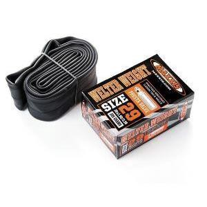

En rando VTT, il faut prévoir 2 chambres à air

Prévoir deux chambres à air dans ton sac est essentiel pour les longues sorties VTT.

La double crevaison, ça arrive ! Habituellement une fraction de seconde après avoir crié à tes compagnons de route « Hé ! Regardez ça ! ». Les descentes à grande vitesse dans les rochers et les sauts sont connus pour pincer les chambres à air de ton VTT.

Quand je roule avec un groupe, je ne prends que la taille et le modèle de chambre à air adaptés à mon VTT (2 dans le sac, c’est déjà pas mal en place et en poids !). Comme mes collègues peuvent avoir des VTT en 26", 650B ou 29", en valve Presta ou Schrader, il est de plus en plus compliqué de compter sur l’aide d’autrui pour une chambre. Il ne te restera plus qu’à poser une ou des rustines, en espérant que cela suffise pour ta crevaison.

## 2/ Kit de rustines {#rustines}

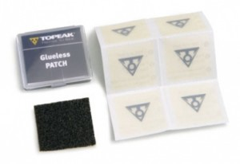

La rustine, l’indispensable de ton sac VTT

Les kits de rustines prennent très peu de place dans ton sac à dos et sont une nécessité lorsque tu as utilisé ta dernière chambre à air. Les rustines sans colle (ci-dessus) sont beaucoup plus rapides à appliquer, mais n’ont pas la longévité des rustines traditionnelles à colle. L’avantage : pris au dépourvu lors d’une rando, tu répareras ta crevaison bien plus rapidement qu’avec leur grande sœur.

## 3/ Pompe à main {#pompes}

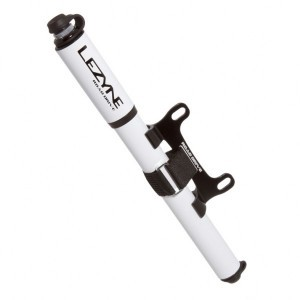

La pompe à main est le must-have de ton sac à dos

Les deux premiers éléments sont assez inutiles sans une pompe. Une pompe ou une cartouche CO2, dans ton sac à dos de VTT, te permettra de finaliser la réparation de ta crevaison ; une mini-pompe fonctionnera à chaque fois !

## 4/ Multi-outil {#outils}

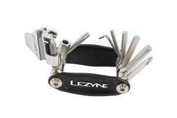

Un multi-outil dans ton sac peut s’avérer très utile !

Ne quitte jamais la maison sans un bon multi-outil. J’opte toujours pour un multi-outil avec un dérive-chaîne, un Torx T25, un tournevis plat et un cruciforme Phillips, et au moins des clés Allen de 2,5, 3, 4, 5, 6 et 8 mm. Si ton multi-outil a une pince coupante, c’est encore mieux.

## 5/ Démonte-pneus (×2) {#demontes-pneus}

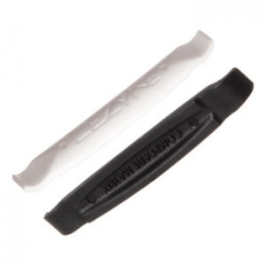

Démonte-pneus

Alors que de nombreux multi-outils ont un démonte-pneu intégré, ils ne sont généralement ni aussi pratiques ni aussi solides que des démonte-pneus séparés. Alors emporte-les dans ton sac à dos de VTT, ils sauront être utiles !

## 6/ Pompe à fourche {#pompe-suspension}

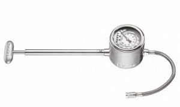

Pompe pour fourche et amortisseur

Les amortisseurs à air modernes sont assez fiables, mais c’est toujours une bonne idée d’avoir dans son sac une pompe pour fourche et amortisseur, au cas où tu aurais une fuite lente ou (plus probablement) si tu trouvais que tu as besoin d’affiner ta suspension au cours de ta balade.

## 7/ Lubrifiant pour chaîne {#lubrifiant}

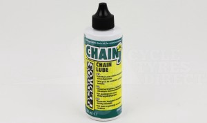

Lubrifiant pour chaîne

Si tu risques de traverser plusieurs cours d’eau, de rouler sur une piste poussiéreuse ou de prendre une averse, une petite bouteille de lubrifiant pour chaîne peut être utile. Astuce : enroule un chiffon autour de la bouteille, tenu par un élastique. Utilise-le pour nettoyer la chaîne avant d’appliquer le lubrifiant, et pour essuyer l’excès après.

## 8/ Baume à lèvres {#baume}

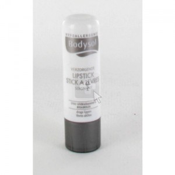

Baume à lèvres

Garder un bâton de baume à lèvres (de préférence avec un indice SPF) dans ton sac à dos est une bonne idée lorsque tu roules dans des environnements secs.

## 9/ Crème solaire {#creme}

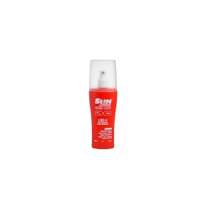

Crème solaire pour vélo

L’été, nous profitons de longues sorties au soleil, ce qui signifie aussi une plus grande exposition aux UV, qui sont cancérigènes. Emporte une petite bouteille d’écran solaire (FPS 30 ou plus) et réapplique-la si nécessaire.

## 10/ Téléphone {#telephone}

Téléphone pour les appels d’urgence

Le téléphone, et notamment le smartphone, peut faire un certain nombre de choses utiles, mais le plus important reste de téléphoner à la maison en cas d’urgence. Assure-toi d’avoir un numéro « en cas d’urgence » enregistré dans le carnet d’adresses de ton téléphone.

## 11/ Veste de pluie ultra-light {#veste}

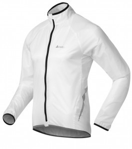

Veste de pluie compactable

Le temps est imprévisible. Une veste compactable et imperméable te gardera au sec et au chaud si tu rencontres une averse soudaine.

## 12/ Kit de premiers secours {#kit-secours}

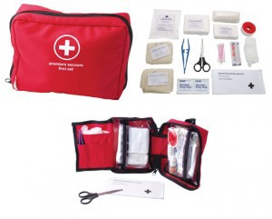

Kit de premiers secours

Une petite trousse de premiers soins dans un emballage étanche est indispensable. Bandages, compresses, lingettes désinfectantes et pince à épiler sont des éléments à inclure dans ta trousse. Comme les outils de cette liste, une trousse de premiers soins n’est utile que si tu sais comment l’utiliser : connaître les bases des premiers soins peut être utile.

## 13/ Patte de dérailleur {#patte-derailleur}

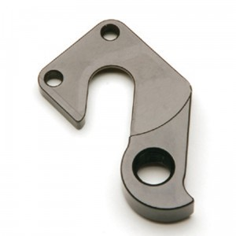

Patte de dérailleur du modèle de ton VTT

Une patte de dérailleur tordue ou cassée peut signifier la fin de ta sortie (ou une conversion impromptue en single speed). Une patte de rechange adaptée à ton cadre est une bonne sécurité à avoir dans ton sac de rando.

## 14/ Maillons de chaîne supplémentaires avec maillon rapide {#maillon}

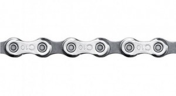

Maillons de chaîne supplémentaires

Garder quelques maillons de chaîne, avec un maillon rapide, dans ton sac te permettra de remplacer un maillon tordu ou cassé et de repartir avec ton VTT.

## 15/ Vis de plateaux {#vis}

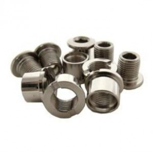

Vis de plateau pour ton VTT

Les vis de plateau peuvent se cisailler ou se desserrer. En garder une de rechange dans ton sac te permettra de continuer sans abîmer tes plateaux.

## 16/ Cales de rechange et plaque de fixation {#cales}

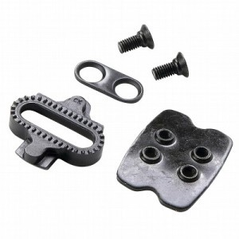

Cales VTT de rechange

Ça arrive rarement, mais quand une cale casse, c’est un calvaire qui commence : on est contraint de pédaler tel un unijambiste. Garde un sachet avec les vis, la cale et la plaque (la partie qui va dans ta chaussure) dans ton sac. De cette façon, tu as les trois pièces si tu en as besoin. Astuce : garde la cale vissée à sa plaque pour ne perdre aucun élément.

## 17/ Rilsan {#rislans}

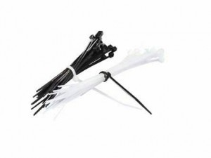

Rilsan

Les Rilsan sont utiles dans beaucoup de situations : attacher un câble qui pend, remplacer une vis de plateau cassée ou manquante, ou garder tes chaussures serrées en cas de rupture de la boucle.

## 18/ Rayon et tête de rayon {#rayon}

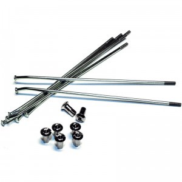

Rayon et tête de rayon

Garde dans ton sac un rayon de rechange et sa tête de rayon, au cas où.

## 19/ Argent {#argent}

Un peu d’espèces

Quelques euros au fond du sac servent à s’offrir une bière ou un apéro, et un billet peut aussi dépanner comme rustine de pneu.

## 20/ Un éclairage compact {#eclairage}

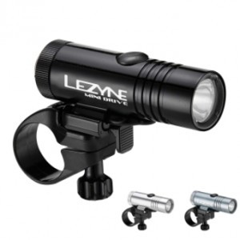

Éclairage vélo et frontale

S’il y a une chance que tu ne sois pas à la maison avant la nuit, une petite lumière, juste assez lumineuse pour éclairer ton chemin, te mènera en toute sécurité à la maison.
