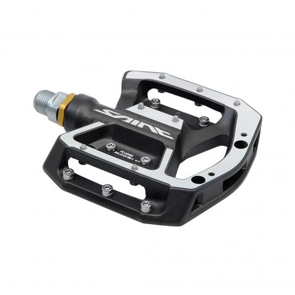
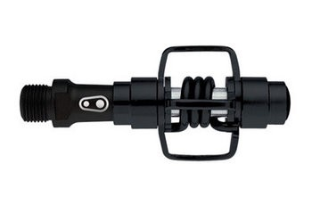
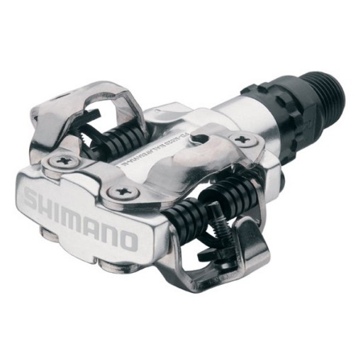
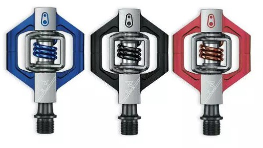
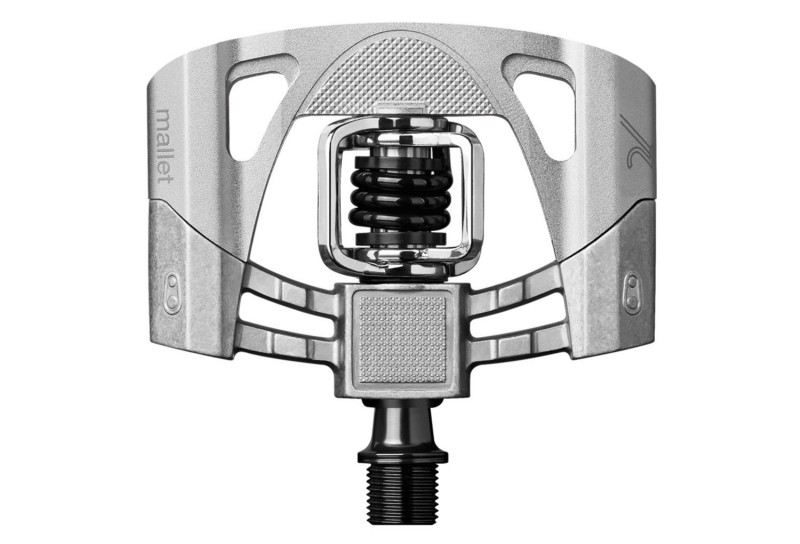

## Au programme

1. [Faut-il changer ses pédales plates pour des pédales automatiques ?](#preambule)
2. [Avantages et inconvénients de la pédale plate traditionnelle](#pedales-plates)
3. [Avantages et inconvénients de la pédale automatique](#pedales-automatiques)
4. [Connais-tu les pédales automatiques « hybrides » ?](#pedales-hybrides)
5. [Conclusion : la pédale automatique, c’est pour qui ?](#conclusion)
6. [Notre sélection de pédales VTT](#best-of)

## 1/ Faut-il changer ses pédales plates pour des pédales automatiques ? {#preambule}

À 15 ans ou à 75 ans, tu veux progresser en VTT ou faire évoluer ta pratique. Dès lors, une longue et fastidieuse quête d’information commence : amis, forums, vendeurs… tous les avis sont bons pour choisir entre rester en pédales plates ou avoir la sensation de réapprendre le VTT, pendant quelque temps, à cause des pédales automatiques.

Comment choisir entre les pédales plates et les pédales automatiques ? Cette question sépare les pratiquants de VTT en deux camps, tous deux bien arrêtés sur leur réponse tant elle leur semble évidente : d’un côté les aficionados de la pédale plate et de l’autre ceux de la pédale automatique.

## 2/ Avantages et inconvénients de la pédale plate traditionnelle {#pedales-plates}

*Pédales plates Shimano Saint PD-MX80*

La pédale plate, c’est la pédale de nos débuts, la base du vélo, celle qui nous rappelle qu’à 2 ans, papa nous avait poussés pour voir si l’on était capable de voler avec un vélo sans roulettes et qui nous permettait de nous rattraper sur nos pieds.

C’est aussi celle que choisissent les pilotes en BMX freestyle pour être totalement libres de leurs mouvements et faire parler leur créativité et leur style.

Bien plus dangereux en VTT qu’un chasseur dans les bois, nos pédales « pièges à loups » sont aussi réputées pour leur grip que pour leur fâcheuse habitude de nous envoyer aux urgences pour quelques points de suture et quelques tibias bien charcutés après un retour de pédale…

Les pédales plates restent avant tout des pédales idéales pour débuter et se faire la main techniquement en VTT. Elles offrent une surface d’appui importante et une adhérence élevée !

### a) Les avantages de la pédale plate

- Confort d’usage : les pieds sont libres et le dégagement est plus aisé en cas de danger.
- Pratique : la prise en main est naturelle.
- Simple : moins d’entretien.
- « Économique » : si l’on se réfère à une gamme similaire en automatique, et que l’on ne considère pas l’usure des semelles.
- Réglage : les pédales plates ne demandent ni réglage, ni ajustement d’angle, ni apprentissage.

### b) Les inconvénients de la pédale plate

- Rendement insuffisant : pédalage de type « piston », avec un travail musculaire uniquement en poussée.
- Maintien insuffisant : retours de pédale fréquents et douloureux, mauvaise tenue dans les sauts et les zones à forte vibration (pierriers, par exemple).
- Poids : souvent mal finies, les pédales de base sont assez lourdes.

## 3/ Avantages et inconvénients de la pédale automatique {#pedales-automatiques}

*Pédale automatique VTT Crankbrothers Egg Beater*

Plus répandue auprès des cyclistes que des VTTistes, la pédale automatique trouve ses origines sur la route avec la marque Look, précurseur dans le domaine : elle a remplacé les bons vieux cale-pieds, avec les mêmes objectifs, performance et rendement.

Créée par Shimano au début des années 1990 pour le VTT, la pédale automatique a trouvé son public auprès des VTTistes en cross-country et en enduro. En descente, les avis sont plus partagés, mais une grosse majorité en est équipée : les trois meilleurs temps de Champéry 2011 dans des conditions très difficiles sont signés par des pilotes roulant en pédales autos (Hart, Brosnan et Spagnolo).

En diminuant le point mort au pédalage, les pédales automatiques augmentent le rendement : contrairement aux pédales plates, grâce à la fixation du pied sur la pédale, le pilote peut pousser d’une jambe et tirer de l’autre, et mécaniquement avoir une traction sur sa transmission plus continue, plus précise et plus efficace.

Une fois la cale bien réglée (au montage), le pied, bien fixé sur la pédale, aura à tout moment une position optimale pour forcer sur celle-ci : le gain en rendement se fera ressentir.

Lors du montage des cales sur les chaussures, tu dois positionner les cales de manière précise : d’abord en réglant correctement le recul, qui doit permettre d’avoir la cale alignée avec ton métatarse (l’articulation du gros orteil), ensuite avec un angle neutre (centré) que tu feras évoluer au besoin en respectant l’angle que prend ta cheville au pédalage. <em>Attention à bien positionner les cales, car un mauvais réglage peut entrainer des blessures telles que des tendinites. Dès la première douleur, recommence le réglage ; au besoin, consulte un spécialiste et fais-toi aider par ton mécano pour le réglage des cales !</em>

Pour libérer ton pied de la pédale, un simple mouvement du talon vers l’extérieur suffit.

Pour utiliser des pédales automatiques, il te faudra des chaussures spécifiques, à semelle rigide et équipées de pas de vis réglables, pour accepter les cales.

### a) Les avantages de la pédale automatique

- Rendement optimisé : travail musculaire simultané des deux jambes.
- Sécurisant : contrôle du vélo en toutes circonstances.
- Poids peu élevé.

### b) Les inconvénients de la pédale automatique

- Économique : pour s’équiper, achat obligatoire des pédales et des chaussures, puis changement des cales à l’usage.
- Début délicat : des chutes à l’arrêt, souvent vexantes, le temps de l’adaptation (1 semaine à 1 mois).
- Physiologique : travail musculaire plus complet, risque de tendinites si les cales sont mal réglées.

### c) Quelques conseils aux débutants en pédales auto

Exerce-toi à plat et avec de la place : clipse et déclipse un bon nombre de fois avant de prendre les sentiers. Vas-y par paliers de difficulté et d’engagement. Tu éviteras ainsi quelques bonnes boîtes vexantes et inutiles.

## 4/ Connais-tu les pédales automatiques « hybrides » ? {#pedales-hybrides}

Les pédales automatiques hybrides te permettent de sortir proprement des passages techniques grâce à une plateforme qui permet de rouler déclipsé.

Chose très rare sur des pédales automatiques, certaines cages sont équipées de picots réglables pour une excellente accroche.

Cet équipement conviendra parfaitement à ceux qui cherchent un pédalage efficace et qui n’hésitent pas à sortir le pied dans les courbes.

La conclusion est simple pour ce type de pédale : tu retrouves tous les avantages de la pédale plate lorsque tu es déclipsé, et tous ceux de la pédale automatique lorsque tu es clipsé.

Côté inconvénients, hormis le poids, difficile d’en trouver !

## 5/ Conclusion : la pédale automatique, c’est pour qui ? {#conclusion}

Rouler en pédale automatique reste moins naturel que la pédale plate.

La pédale automatique restera totalement inadaptée aux pratiques les plus fun : dirt, street, trial.

Si tu parcours des kilomètres tous les week-ends en rando, cross-country ou enduro, essaie les pédales automatiques dès lors que tu maîtrises ton VTT, et tu te feras ton propre avis. Mais garde en tête que sans elles, à forces égales avec tes collègues, tu perdras en rendement.

Pour la descente, chacun a sa réponse en fonction de son pilotage ; il faut garder en tête que la pédale automatique permettra un meilleur rendement et plus de précision dans ses appuis.

## 6/ Notre sélection de pédales VTT {#best-of}

*Paire de pédales Shimano SPD-M520 argent (économique)*

*Paire de pédales Crankbrothers Candy 3 (XC et enduro)*

*Paire de pédales Crankbrothers Mallet 2 (enduro et DH)*

*Pédales Shimano Saint PD-MX80 (enduro et DH)*
