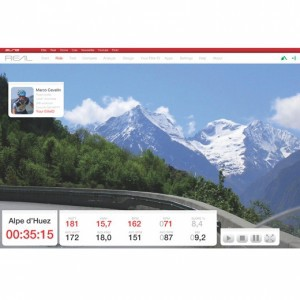
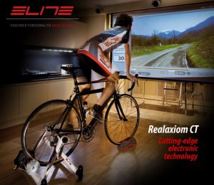
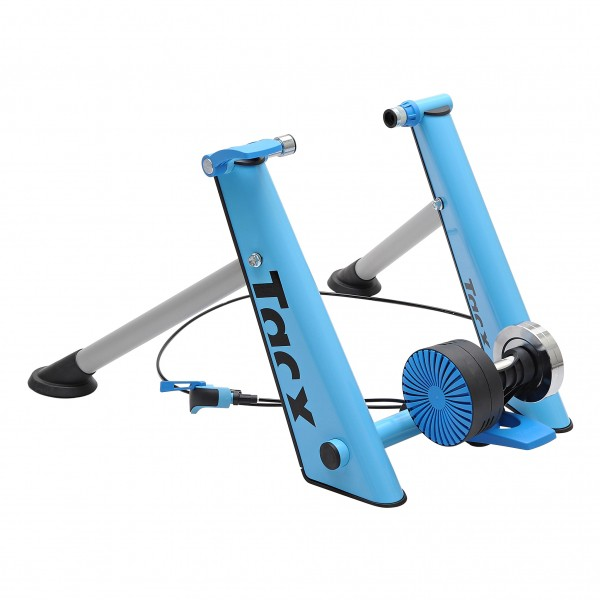
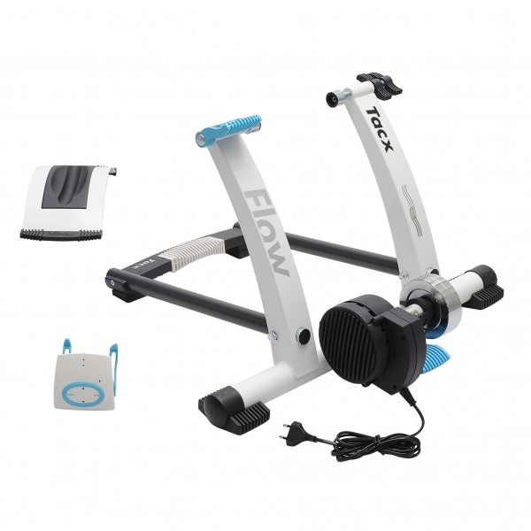
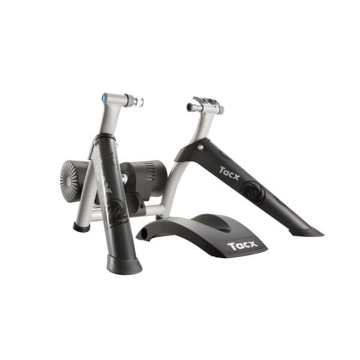
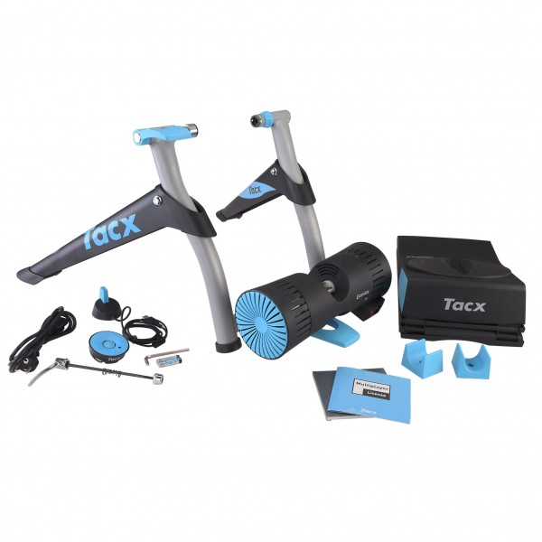

Au programme :

1. [L’home-trainer est ton meilleur ami lors des changements de saison et d’heure !](#preambule)
2. [1/ Choisir son mécanisme d’home-trainer](#mecanisme)
3. [Avantages et Inconvénients des différents rouleaux d’home-trainer](#avantagnes-inconvenients)
4. [L’home-trainer jusqu’aux limites de la réalité virtuelle](#realite-virutelle)
5. [Les principales caractéristiques de l’Home-Trainer](#caracteristique)
6. [Quelques conseils d’utilisation de ton home-trainer](#conseils)
7. [Notre sélection d’home-trainer](#selection)

## L’home-trainer est ton meilleur ami lors des changements de saison et d’heure ! {#preambule}

Plus humides, plus froides et plus ventées, d’octobre à mars, les saisons mènent à mal ta soif de VTT. C’est lorsque le temps change et que le soleil devient plus fainéant que tes habitudes sont chamboulées. Pour ceux qui veulent continuer à s’entraîner sérieusement en VTT et progresser, le home-trainer sera bien utile en cardio-training et garder la forme ! L’home-trainer reste le meilleur moyen de continuer avec son VTT en intérieur!

On trouve différents modèles d’Home-Trainer. Chaque gamme est construite pour te redonner des sensations au plus proche de la réalité lors de tes rides en VTT. Néanmoins, la grille de prix va définir plusieurs niveaux de finitions.

Il devient alors important pour toi de choisir l’home-trainer qui sera le bon compagnon d’entrainement et le bon investissement.

Les modèles d’entrée de gamme remplacerons les petites sorties estivales d’entretien, pour un usage ponctuel et sans efforts puissants.

Pour les utilisateurs cherchant un outil d’entrainement performant, regarde du côté des modèles d’home-trainer offrant une bonne résistance et un ordinateur de bord pour suivre les indicateurs de performance, type ergo-trainers et virtual-trainers.

Sportif amateur ou professionnel, l’home-trainer est aujourd’hui devenu un outil essentiel.

## 1/ Choisir son mécanisme d’home-trainer {#mecanisme}

Il existe trois familles de home-trainer :

### Home-trainer avec système à air :

- La résistance permet de simuler une montée plus ou moins raide. Gestion de la difficulté se gère simplement avec les plateaux et les vitesses du VTT.

* Assez bruyant et peu ou pas de résistance au pédalage. Absence de réglage de résistance

### Home-trainer avec système Magnétique :

- Bon rapport qualité/prix. Permet une résistance sportive au pédalage.

* Bruyant

### Home-trainer avec système fluide :

- Silencieux, souple et réaliste avec des gestions de puissances élevées.

* Prix

## 2/ Avantages et Inconvénients des différents rouleaux d’home-trainer {#avantagnes-inconvenients}

### Rouleau home-trainer plastique

- bon marché, faible consommation de pneu

* adhérence limitée, bruyant

### Rouleau home-trainer métal

- bonne adhérence, résistance et durée de vie

* consommation des pneus forte

### Rouleau home-trainer gel

- bonne adhérence, économise les pneus, absorbe les vibrations et peu bruyant

* budget

## 3/ L’home-trainer jusqu’aux limites de la réalité virtuelle {#realite-virutelle}

Du moins cher au plus onéreux :

### Cyclotrainers

Le Cyclotrainers est un Home-trainer avec ou réglage de la dureté, celle-ci pourra se régler avec une molette qui durcie l’inerte du rouleau.

### Ergotrainers

L’ergotrainer est un Home-trainer qui comporte un compteur qui recueil plusieurs informations: vitesse, puissance, cadence, distance, …. et permettra de gérer la difficulté de l’effort parfois avec des programmes pré-définis.

L’ergotrainer peut celon le modèle évoluer vers un Home Trainer Virtuel grâce à un kit qui le transforme en Home Trainer virtuel.

### Virtual Trainer

*Home Trainer ELITE REALPOWER WIRELESS*

Le virtual Trainer est un home-trainer qui te fera voyager sur les pentes les plus prestigieuses du globe, te frotter au peloton, participer à des courses virtuelles, programmer des entrainements.

L’entraînement devient plus ludique grâce à un logiciel type “jeux vidéo” ou “DVD” reprenant la montée d’un col, une étape du tour de France et pleins d’autres moment mythique du vélo immortalisé sur écran. Une connexion internet te permettra de te mesurer à d’autres cyclistes. Attention à bien choisir ton modèle, car certaines options peuvent être payantes …

Les jeux en réseau ou multiplayers te donneront plus de motivation et assouviront ta soif de compétition.

## 4/ Les principales caractéristiques de l’Home-Trainer {#caracteristique}

### Un home-trainer à quatre pattes :

Il est très important que ton home-trainer soit stable. Le nombre de points d’appuis au sol est très important pour avoir une bonne stabilité. L’idéale, un home trainer à quatre pieds avec des caoutchoucs tendres ou sur ressort pour absorber les vibrations.

### La roue d’inertie un facteur d’évolution :

Pour évoluer lors de tes entraînements sur home-trainer, il est important qu’il ai une bonne roue d’inertie, cela t’évitera des sensations de saccade très importantes et te garantira un pédalage plus souple. Tu auras également la possibilité d’évoluer avec de plus fortes résistances (PMA, travail de force..). Plus tu montes en gamme plus la roue d’inertie de l’home trainer sera importante.

### Système de fixation de la roue arrière :

La fixation du vélo sur l’home-trainer est importante, il doit être pratique pour monter et enlever le vélo simplement. Il doit être costaud pour ta sécurité et éviter tout mauvais traitement à ton VTT.

### Le refroidissement:

Le bloc de freinage peut rapidement devenir brulant s’il n’est pas bien ventilé par des ailettes de ventilation, celles-ci montées afin d’éviter la surchauffe.

### Rangement

Opte pour un modèle d’home-trainer qui se plie et se range facilement.

### Nettoyage

Choisir un modèle d’home-trainer qui se nettoie facilement est un plus.

## 5/ Quelques conseils d’utilisation de ton home-trainer {#conseils}

Home Trainer ELITE REALPOWER WIRELESS

### Tue l’ennui

musique, film, TV, tout est bon pour que les séries passe plus vite lors de tes entraînements !

### Bois

l’home-trainer ne permet pas de ventilation pour tempérer ton corps, ce sera alors naturellement que ton corps transpirera pour se refroidir. N’oublie pas de te réhydrater régulièrement. Une serviette peut te donner un peu de confort et surtout te permettre de protéger ton vélo de l’acidité de la transpiration. La transpiration abondante provoquée par l’home-trainer peu causer la déshydratation et peu ainsi avoir pour conséquence: fatigue, tendinites et une perte d’oligo-éléments.

### Ventile

Ouvre les fenêtres, branche le ventilateur, la ventilation de la pièce te permettra également de lutter contre la déshydration.

### Rehausseur la roue avant

Rehausse la roue avant du vélo pour la mettre à niveau avec ta roue arrière. En effet, lorsque ton vélo est sur home-trainer, la roue arrière est surélevé, la position t’amènera rapidement vers le bec de selle si tu ne corriges pas le niveau. Plusieurs modèles d’home-trainer dispose de se support dans le packaging.

### Bruleur de gomme

l’home-trainer par son frottement brûle la gomme de ton pneu arrière plus rapidement surtout sur des pneus de VTT et leur crampons, un pneu spécial pour home-trainer te permet d’économiser tes beaux pneus flambant neuf et permet aussi de diminuer le bruit du frottement sur le rouleau de l’home-trainer.

## 6/ Notre sélection d’home-trainer {#selection}

### Home Trainer TACX BLUE MATIC T2650 (Cyclo-trainer)

*Home Trainer TACX BLUE MATIC T2650*

**Points forts**

- Le frein magnétique du Blue Matic comprend deux disques présentant 6 aimants permanents chacun.
- Manette de résistance au guidon à 10 positions: tu peux régler le positionnement des aimants.
- Durant l’entraînement, la résistance augmente quand tu roules plus vite ou dans un mode plus résistant.
- Système très simple de montage qui permet une fixation aisée et rapide de ton vélo.
- Résistance maximale de 700 W.
- Compatible roues: 650, 700, 26 et 29 (si utilisation d’un pneu spécifique à petit profil)
- Livré avec serrage rapide.

### Home Trainer TACX I-FLOW T2270 (Ergo-trainer)

*Home Trainer TACX I-FLOW T2270*

**Points forts**

- Entraînement avec PC, logiciel Tacx Trainer software 4 basic (Vista ou Windows 7) ;
- Calcule la puissance, la cadence, le rythme cardiaque, la distance… ;
- Interface de guidon ;
- Support de roue avant Skyliner compris ;
- Frein électromagnétique silencieux (6 aimants permanents, 6 électro-aimants réglables, volant d’inertie de 2 kg) ;
- Puissance maximale : 800 watts (réglables en pourcentages) ;
- Vitesse virtuelle signalée en cas de dépassement des capacités du frein sur un parcours.
- Livré avec serrage rapide.

### Home Trainer TACX BUSHIDO Smart T2780 (Virtual trainer)

*Home Trainer TACX BUSHIDO Smart T2780*

Trainer interactif Smart doté de l’unité de résistance la plus puissante, le home trainer TACX Bushido Smart T2780 ravira les coureurs en quête de réalisme.

Equipé d’un frein motorisé électrique qui assure un pédalage fluide, même lors de l’ascension de pentes raides, le Bushido dispose ainsi d’une résistance maximale de 1.400 W contrôlée et ajustée constamment pour reproduire la résistance naturelle de la route, de l’air, le pourcentage de pente, le poids, la pression atmosphérique, la vitesse du vent, la température, l’altitude, et l’inertie afin d’aboutir à une sensation réaliste.

Extrêmement ergonomique et fonctionnant complètement sans fil — y compris pour son alimentation — grâce aux technologies ANT+ et Bluetooth® Smart, le home trainer Bushido peut être utilisé avec une tablette ou un smartphone pour visualiser la vitesse, la cadence de pédalage et la puissance et profiter des applications du logiciel Tacx Cycling.

Cette application permet notamment de prendre part à des courses cyclistes classiques et à des étapes de légende. Tu pourras aussi créer tes propres programmes d’entraînement et t’exercer en fonction de ta fréquence cardiaque, de la pente et de la puissance produite, ou utiliser les tests prédéfinis de niveaux de forme. Toutes tes performances sont mesurées et affichées pendant que tu roules, et enregistrées de façon à les analyser ultérieurement.

**Points forts**

- Très grande résistance pour un réalisme maximal
- Interactivité des applications Tacx Cycling
- Connectivité sans fil

### Home Trainer TACX I-GENIUS Multiplayer Smart T2010 (Virtual trainer)

*Home Trainer TACX I-GENIUS Multiplayer Smart T2010*

**Points forts**

- Frein motorisé repoduisant fidèlement la pression exercée sur la roue arrière ;
- Simulation de pente réaliste ;
- Connectivité totale ;
- Pack complet pour une intercativité totale et un confort d’utilisation maximal.
