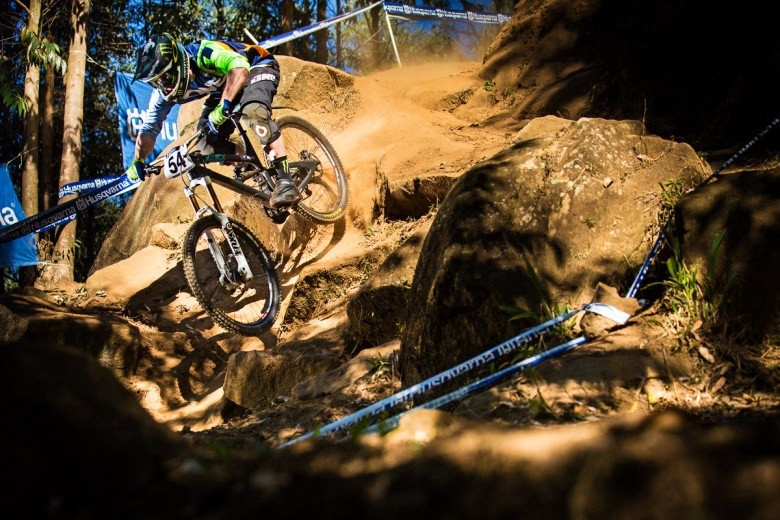

XC, marathon, enduro, DH, de 100 à 200 mm de débattement et plus : presque tous nos VTT ont une fourche télescopique, et souvent un amortisseur. Un tout-suspendu gagne en stabilité, en confort et en adhérence, à condition que ses suspensions soient bien réglées. Voici une méthode simple pour régler la fourche et l’amortisseur de votre VTT.

## L’ordre des réglages

Le réglage reste simple si l’on suit toujours le même ordre :

1. [Le ressort et le SAG](#ressort)
2. [La compression](#compression), puis [le blocage](#blocage)
3. [La détente](#detente)
4. [Le débattement variable](#debattement), si votre fourche en a un

Adaptez ensuite le réglage au terrain, à votre pilotage et à la température.

<iframe title="Vidéo YouTube : régler les suspensions d’un VTT" width="auto" height="315" src="https://www.youtube.com/embed/aXZ_WWjIQdA" frameborder="0" allow="autoplay; encrypted-media" allowfullscreen></iframe>

## Le ressort et le SAG {#ressort}

### À quoi sert le ressort

Une suspension fonctionne d’abord comme un ressort. Celui-ci se définit par le poids qu’il supporte avant de s’enfoncer. Il s’adapte au poids du pilote, au terrain et au style de pilotage.

Il existe trois systèmes :

- le couple ressort et élastomère, sur les fourches premier prix ;
- l’air ;
- l’huile.

L’air et l’huile sont utilisés seuls ou ensemble sur les fourches de moyenne et haut de gamme.

Sur un système à ressort et élastomère ou à bain d’huile, une molette durcit le ressort. Sur une fourche ou un amortisseur à air, on règle la pression avec une pompe haute pression, qui peut monter jusqu’à 200 psi. Si vous n’en avez pas pour votre Fox, RockShox, SR Suntour ou Boss, équipez-vous.

Pour durcir ou assouplir nettement une fourche à ressort et élastomère, il faut changer les élastomères pour des modèles plus durs ou plus souples, adaptés à votre fourche.

### Régler le SAG

Le SAG, c’est l’enfoncement de la suspension à l’arrêt, sous votre seul poids.

1. Mesurez le débattement total de la fourche, du collier à la base du plongeur.
2. Placez le collier tout en bas.
3. Équipez-vous comme pour rouler : casque, sac, chaussures. Tout ce poids pèse sur les suspensions.
4. Montez doucement sur le VTT.
5. Visez un SAG de 15 à 20 % du débattement en XC, de 20 à 30 % pour une pratique plus engagée, de l’enduro à la DH.
6. Ajustez avec la pompe haute pression et notez la valeur.

### Les erreurs à éviter

- **Un ressort trop dur** empêche la suspension de fonctionner : vous perdez l’intérêt des réglages de compression et de détente.
- **Un ressort trop mou** abîme le matériel : la suspension talonne souvent sur les gros chocs, même en XC.
- **La température change la pression.** L’air ne réagit pas de la même façon à 0 °C et à 30 °C : vérifiez la pression chaque mois. L’hiver, l’air se comprime, ajoutez environ 5 % de pression ; l’été, il se dilate, retirez-en environ 5 %. C’est le conseil que m’a donné un mécanicien de chez Fox.

*Jared Graves au championnat du monde de DH 2013. Photo yeticycles.com*

## La compression {#compression}

La compression est un réglage hydraulique de la fourche et de l’amortisseur. Il fait varier la vitesse à laquelle la suspension s’enfonce, à basse et à haute vitesse :

- **la basse vitesse** concerne les petits mouvements, liés au pédalage ou au freinage ;
- **la haute vitesse** concerne les grands mouvements, liés aux chocs du terrain et au pilotage.

Pour régler la molette bleue :

1. tournez-la à fond vers le « − » ;
2. tournez-la à fond vers le « + » en comptant les crans ;
3. revenez d’un tiers ou de la moitié des crans vers le « − ».

La compression reste vive, et vous affinerez à la sensation en roulant.

Une compression forte ralentit la suspension sur les gros chocs et l’aide à les encaisser. Trop lente, elle oblige le pilote à absorber les gros chocs avec son corps, et le VTT devient moins stable à haute vitesse.

## Le blocage {#blocage}

Le blocage de compression est apprécié en montée et sur les portions roulantes. Il ralentit ou empêche la circulation de l’huile dans la chambre. Par sécurité, il se libère sur un gros choc pour ne pas endommager la suspension.

### Le blocage ne fonctionne plus

Commencez par la commande au guidon, si votre fourche ou votre amortisseur en a une. Tout se joue sur la tension du câble :

- **la suspension ne se bloque pas** : le câble n’est pas assez tendu. Tendez-le avec la molette de réglage de la commande, par petits tours ;
- **la suspension ne se débloque plus complètement** : le câble est trop tendu. Détendez-le de la même façon.

Si la molette en haut de la fourche ne bloque pas non plus, ou si le câble n’y est pour rien, le problème vient de la cartouche hydraulique : son huile ou ses joints. Ce n’est plus un réglage. Les constructeurs prévoient un entretien en heures de roulage, propre à chaque modèle et à chaque année : chez RockShox, par exemple, le bas de fourche toutes les 50 heures, et une révision complète à 100 ou 200 heures selon le modèle. Consultez le manuel de votre modèle, et confiez la cartouche à un atelier ou au centre de service de la marque.

## La détente {#detente}

La détente, c’est l’inverse de la compression : la vitesse à laquelle la suspension revient en position. Toucher à la compression oblige à revoir la détente.

En phase de détente, l’huile repasse de la chambre de compression à sa position de départ par un conduit réglable, qui accélère ou ralentit son passage.

Un mauvais réglage a de lourdes conséquences pour le pilote comme pour le vélo :

- **une détente trop rapide** fait perdre de l’adhérence ;
- **une détente trop lente** augmente le risque de talonner : sur des chocs répétés, la fourche n’a pas le temps de revenir en position, et elle s’abîme.

### La méthode conseillée

Pour la fourche comme pour l’amortisseur, réglez la molette rouge :

1. tournez-la à fond vers le « − » ;
2. tournez-la à fond vers le « + » en comptant les crans ;
3. revenez d’un tiers des crans vers le « − ». Par exemple, 12 crans du « − » au « + » : revenez de 4 crans.

La détente reste vive, et vous affinerez à la sensation en roulant.

### La méthode sans outil

- **L’amortisseur** : laissez tomber votre vélo, il ne doit pas rebondir.
- **La fourche** : descendez un trottoir assez haut, à peu près de la hauteur de votre débattement. Si vous vous sentez projeté par-dessus le guidon une fois la roue posée, ralentissez la détente.

## Le débattement variable {#debattement}

Il fait correspondre l’assiette du vélo à la pente et adapte la fourche à la géométrie du vélo. Très apprécié dans les montées raides. Les modèles de base proposent 3 à 5 positions, d’autres bien davantage.

## Ma sélection de fourches et amortisseurs

- **Fourche XC** : Fox 32 Step-Cast Factory, 100 mm de débattement, la plus légère de Fox.
- **Fourche enduro** : RockShox Lyrik Ultimate, cartouche Charger 3.1, 140 à 160 mm, en 27,5 ou 29 pouces.
- **Amortisseur XC et marathon** : Fox Float SL Factory, qui remplace le Float DPS.
