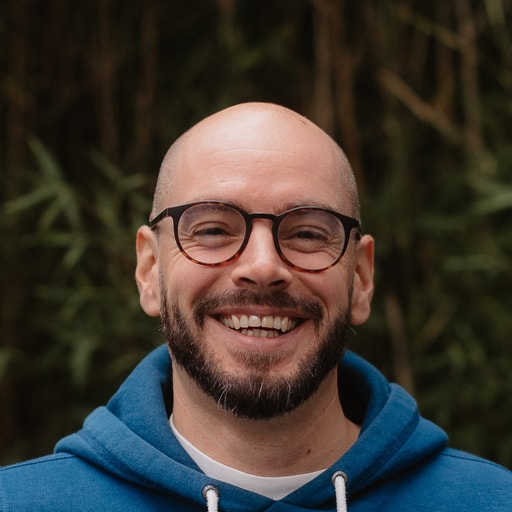
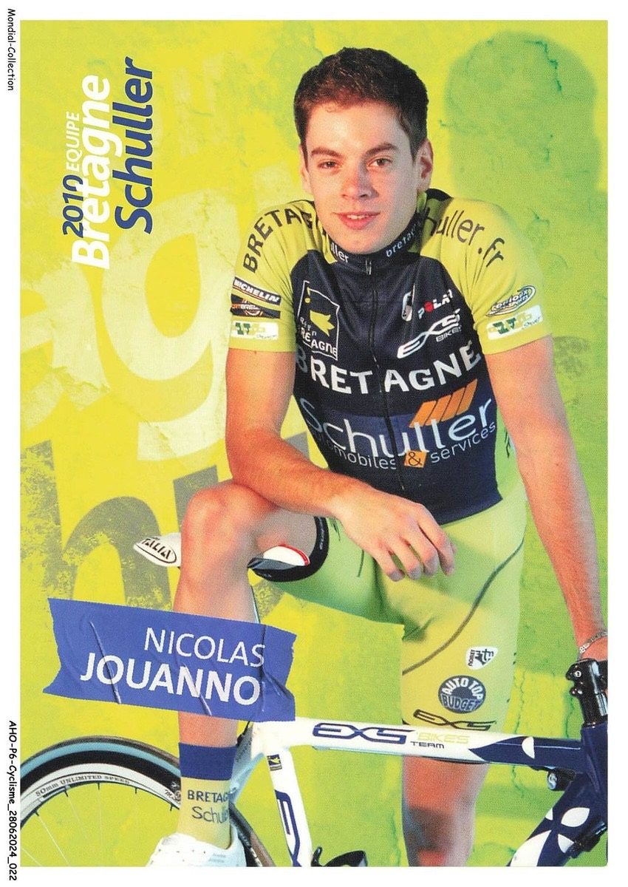
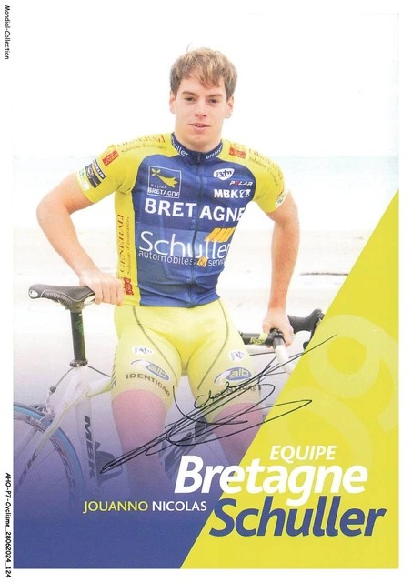

<hgroup class="u-text--center">
  <h1>J’explore l’Europe en famille, en van, à la recherche de sentiers et d’assiettes sans gluten.</h1>
  
Je raconte ce que nous trouvons en chemin et je construis les outils qui nous manquent.

</hgroup>

<data class="p-name" value="Nicolas Jouanno"></data><data class="u-url u-uid" value="https://www.nicolasjouanno.com/"></data>

Le vélo a d'abord donné le rythme. J'ai été [cycliste professionnel]({{ site.author.wikipedia }}) chez Bretagne Schuller. J'ai pris part à cinq championnats de France, avant qu'une blessure ne m'oblige à raccrocher. Mon [palmarès cycliste](#palmares) retrace ces saisons.

Aujourd'hui, je roule et je cours autrement. Avec ma famille, nous parcourons l'Europe en van au rythme des vacances, avec les vélos, les chaussures de trail et la contrainte du sans gluten dans nos bagages.

Je crée sur le web depuis plus de vingt ans : d’abord sur Skyblog et MySpace en 2005, puis sur ce site, en ligne depuis 2008. J’y publie lorsqu’une expérience mérite d’être partagée ou qu’un problème vécu appelle une réponse concrète.

<a href="/posts.html" class="c-button c-button--dark-outline">Voir toutes les publications</a>

## Du vélo au web {#parcours}

Le vélo a été mon premier cadre de travail. Une blessure, en 2010, m’a mis hors course et m’a ouvert la porte du numérique. J’y suis entré par l’entrepreneuriat et la communication digitale ; le code s’est imposé ensuite, appris sur le tas et mis en production.

Aujourd’hui, je suis Lead développeur frontend dans la core team de [MGDIS](https://github.com/MGDIS). Je développe et maintiens le design system, avec les Web Components et l’accessibilité RGAA comme exigences de départ. Ce parcours explique aussi les outils que je construis à partir de besoins vécus, sans faire de ce site un portfolio.

### Repères

- Depuis <time datetime="2019">2019</time>, je travaille chez [MGDIS](https://github.com/MGDIS) sur le design system : Web Components, SCSS, accessibilité RGAA et accompagnement des équipes. En <time datetime="2025">2025</time>, j’ai présenté à [Paris-Web](/paris-web-2025.html), avec Simon, notre retour d’expérience sur un design system accessible by design.
- De <time datetime="2016">2016</time> à <time datetime="2019">2019</time>, chez REF SPORT, j’ai mené des applications web, du besoin et du prototypage jusqu’au design d’interface, à la mise en production et aux supports de communication.
- Entre <time datetime="2011">2011</time> et <time datetime="2016">2016</time>, Twinner Sport puis cyclesportnature.fr m’ont fait passer du web éditorial et e-commerce à la responsabilité d’une activité : communication, site, SEO, newsletters, équipe et budget.
- Depuis <time datetime="2008">2008</time>, je tiens nicolasjouanno.com. En <time datetime="2013">2013</time>, j’ai lancé vtt.bzh pour répondre à une question de pratiquant : où rouler dimanche ? Ce calendrier vit aujourd’hui sur la page [Événements]({{ site.projects.events.url }}).
- En <time datetime="2026">2026</time>, j’ai repris [feezify](https://feezify.nicolasjouanno.com/fr/), un carnet d’entraînement initié en <time datetime="2018">2018</time>, pour comprendre les systèmes agentiques de l’intérieur. Je l’ai arrêté en septembre.

  <ul class="c-button-stack c-button-stack--center u-list">
    
    <li>
      
    </li>
    
    
    <li>
      
    </li>
    
  </ul>

## Outdoor — VTT & trail

Après le bitume, je suis revenu à ma passion d’origine : le VTT. J’ai essayé de renouer avec les dossards, mais j’ai vite cherché une pratique plus libre, plus fun.

vtt.bzh est né en 2013 d’une question simple : où rouler dimanche ?

Puis j’ai voulu redécouvrir les sentiers autrement. C’est là que j’ai découvert le trail et commencé à prendre plaisir avec une simple paire de baskets.

  <a href="/events/" class="c-button c-button--dark-outline">Outdoor</a>

## Sans gluten

La maladie cœliaque est entrée dans notre vie familiale et a changé des gestes ordinaires : faire les courses, cuisiner ou choisir un restaurant. Le [quiz « Gluten ou pas gluten ? »](/apps/gluten-not-gluten/) est né pour rendre cette vigilance visible et plus facile à partager.

## Palmarès cycliste {#palmares}

Les résultats détaillés conservés ici couvrent 2007 à 2010. La participation au Championnat de France de cyclo-cross 2004 fait aussi partie de ce parcours.

### Les temps forts

Participation à 5 championnats de France :

- Championnat de France Route Professionnel 2010
- Championnat de France Route Professionnel 2009
- Championnat de France Route amateur 2008
- Championnat de France Route espoir 2007
- Championnat de France Cyclo-cross  2004

### 2010 (Professionnel - Bretagne Schuller)

<figure class="u-spacing--none u-spacing--block-end-medium">
  
  <figcaption class="c-meta u-spacing--block-start-small">Carte Bretagne Schuller, saison 2010.</figcaption>
</figure>

Pas de résultat dans le top 20 : une blessure a écourté la saison.

### 2009 (Professionnel - Bretagne Schuller)

<figure class="u-spacing--none u-spacing--block-end-medium">
  
  <figcaption class="c-meta u-spacing--block-start-small">Carte Bretagne Schuller, saison 2009.</figcaption>
</figure>

#### 2ème

- Boucles de la loire (E)

#### 3ème

- souvenir louison bobet (E)
- souvenir jean floch/ploudalmézeau (E)

#### 5ème

- Tour de Normandie - étape 3 (2.2)

#### 11ème

- Paris-Corrèze - Etape 2 (2.1)

#### 12ème

- Route du sud - Etape 4 (2.1)

#### 15ème

- Mi-août Bretonne - étape 3 (2.2)

### 2008 (Elite - VCP Lorient)

#### victoires

- Général Trophée Crédit Agricole (E)
- Crach (123)
- Marzan (123)

#### 2nd

- flèche de locminé (E)
- Val d'Ille U Classic (E)
- prix de pluvigner (123)
- Ploemel (123)
- Vice champion du morbihan espoir (123)
- Prix Auray (123)
- Cléguérec (123)

#### 3ème

- La roche Foucaud - finale de la Coupe de France DN2/espoir (E)
- Général de la cabri tour (E)
- Contre la montre par équipe Tro div Ster (123)

#### 4ème

- Route bretonne (E)
- Championnat du Morbihan (123)

#### 5ème

- Prix d’Armorique, Ploudalmézeau(E)
- Locoal Mendon (123)

#### 6ème

- Grand prix de la ville de Fougère (E)
- 3ème étape cabri tour(E)

#### 7ème

- 1ère étape cabri tour(E)
- Contre la montre cabri tour (E)
- Prix de la moisson Moréac (E)

#### 9ème

- Général Tro div Ster (123)

#### 10ème

- Général des 3 jours de Cherbourg (3ème jeune)

#### 11ème

- 1ère étape 3 jours de Cherbourg (E)

#### 15ème

- Prix de la ville de Lorient (E)
- Grand prix super U (E)
- Grand prix Gilbert Bousquet (E)

#### Classements annexes:

- Meilleur jeune du grand prix de Fougères (E)
- Meilleur jeune de la cabri tour (Espoir)

### 2007 (Elite - VCP Lorient)

#### Victoires

- Essor étape 1 (E)
- Champion Morbihan espoir (123)
- Cléguérec (123)
- Scaër (123)
- Duo breton (123)
- Quimperlé (123)

#### 2ème

- Essor étape 4 (E)
- Quimper (123)
- Pluvigner (123)
- Belle ile (123)

#### 3ème

- Moncontour (E)
- Banalec (123)

#### 4ème

- Trophée Jean-Jacques Quéré (E)
- Championnat du Morbihan (123)

#### 5ème

- Concarneau (123)
- Névez (123)
- Briec sur Odet (123)
- Prix d’auray (123)

#### 10ème

- Loire Atlantique espoir dernière étape (Espoir)

#### 15ème

- Le ponthou (E)

#### 16ème

- Le pertre (E)

### 2004 (Cyclo-cross)

- Participation au Championnat de France de cyclo-cross.

Ce site suit les conventions de l’[IndieWeb](/indieweb/).
